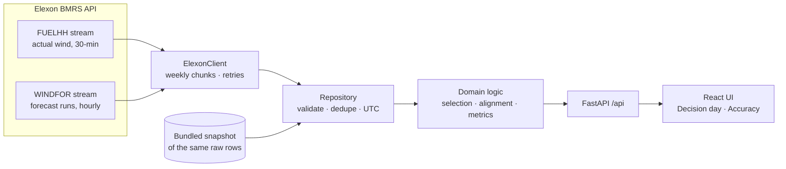

# Wind Forecast Desk

A web app for a UK energy utility's day-ahead trading team. It answers two questions about
national wind generation:

1. **What did the latest wind forecast say at the moment we had to buy power?**
   It shows the forecast as it stood at the day-ahead auction deadline, without using any
   forecast published afterwards.
2. **How far can we trust that forecast?** It measures the error so purchases can allow for it
   (average error, bias, error ranges, planning margins, error by hour, lead time and wind level).

Scope: purchase decisions made in **January 2026** (delivery days 2 Jan to 1 Feb 2026). It uses
only Elexon BMRS national wind data: [FUELHH](https://bmrs.elexon.co.uk/api-documentation/endpoint/datasets/FUELHH/stream)
for actuals (`fuelType = WIND`) and [WINDFOR](https://bmrs.elexon.co.uk/api-documentation/endpoint/datasets/WINDFOR/stream)
for forecasts.

- **Live app:** _add the Vercel URL here after deploying (see [Deployment](#deployment))_
- **Video walkthrough:** _add the unlisted YouTube link here_

| Decision day | Forecast accuracy |
|---|---|
| The forecast available at the deadline (hourly steps) with its likely range, compared with half-hourly actuals. Optionally shows the earlier runs and the runs that arrived too late. | Headline bias, auto-generated findings, planning margins, a month-long comparison, daily error (click a bar to open that day), and error by size, hour, lead time, wind level and decision time. |

---

## Key findings (January 2026, 09:20 EPEX deadline)

| Measure | Value | What it means for the buyer |
|---|---|---|
| Mean absolute error | **2.04 GW** | Typical size of the miss |
| Bias (forecast − actual) | **+1.75 GW** | The forecast was too high in 85% of hours, so buying against it leaves you short |
| 90% of hours within | ±4.10 GW | Worst-case planning range |
| Planning margin, 90% confidence | forecast − 4.10 GW | Wind you can count on 9 times out of 10 |
| High-wind hours (forecast above 20 GW) | bias +4.6 GW | The overestimate grows with wind level; actual output levels off around 17–18 GW |
| Deciding later (e.g. 18:00) | MAE 1.87 GW (−8%) | Waiting for later forecasts gains little |
| Lead time, 0–6 h vs 42–48 h | MAE 1.66 vs 2.33 GW | Accuracy improves closer to delivery, but the bias stays |

The forecast is still about +1.4 GW too high even 0–6 hours ahead. That suggests a
systematic difference rather than weather uncertainty. Likely causes are curtailment (wind
farms told to reduce output when the grid is congested) or the two datasets covering different
sets of wind farms. These should be confirmed with Elexon or NESO before acting on them.

---

## How it works



### The core rule: no information from after the decision

The purchase for delivery day **D** is decided on **D−1** at a configurable UK time. The
presets are the gate-closure times of the GB day-ahead auctions:
**EPEX 09:20** (default) and **Nord Pool N2EX 09:50**. Custom times are also allowed.
For every hour of D:

```
deadline   = (D − 1) at the decision time, UK local → UTC
candidates = forecasts for that hour with publishTime ≤ deadline
used       = the candidate with the latest publishTime
```

- The forecast is selected **per hour, not per run**. If the newest run is missing an hour,
  that hour falls back to the newest earlier run that covers it. Hours with no forecast at all
  are reported as gaps and are not silently dropped.
- Runs published after the deadline are never used for the decision. The UI can show them
  (dashed) to illustrate what arrived too late.
- WINDFOR runs are published about 8 times a day (02:30, 04:30, 07:30, 09:30, 11:30, 15:30,
  18:30 and 22:30 UTC, plus occasional extra runs). At 09:20 the 07:30 run is used; at 09:50
  the 09:30 run is.

### Measuring accuracy

- **Error = forecast − actual.** Positive means the forecast was too high (risk of buying too
  little).
- Forecasts are **hourly** and actuals are **half-hourly**. Each hour is compared with the
  mean of its two half-hours, and an hour missing either half is skipped. The result barely
  changes with other alignments (MAE moves by less than 2%).
- **Metrics:**
  - MAE, RMSE and bias;
  - P10 and P90 of the error, and the P90 of the absolute error;
  - **WAPE** (total absolute error ÷ total actual output). Percentage error per hour (MAPE) is
    not used because wind can be near zero.
- **Planning margin** at confidence *c* is the *c*-quantile of the error, so actual ≥
  forecast − margin in a fraction *c* of hours.
- The **likely range** on the decision view is built from the *other* days' errors, so a day
  never informs its own band.
- The **lead-time curve** uses *every* forecast run. At a fixed decision time, lead time is
  tied to the hour of day, so only the full set of runs shows the effect of lead time alone.
- **"Would deciding later help?"** repeats the whole evaluation at decision times from 00:00
  to 21:00.

---

## Running it

### With Docker (recommended)

```bash
docker compose up --build
```

Open <http://localhost:8000>. One container serves the API and the built UI.

Development stack with auto-reload for the API and hot reload for the UI:

```bash
docker compose -f docker-compose.dev.yml up --build
```

Open <http://localhost:5173>. Vite proxies `/api` to the backend container.

### Without Docker

Requirements: Python 3.12 with [uv](https://docs.astral.sh/uv/), and Node 22.

```bash
# Backend: http://localhost:8000 (interactive API docs at /api/docs)
cd backend
uv sync
uv run uvicorn app.main:app --reload --port 8000

# Frontend: http://localhost:5173 (in a second terminal)
cd frontend
npm ci
npm run dev
```

### Tests and checks

```bash
cd backend && uv run pytest --cov=app && uv run ruff check . && uv run mypy app
cd frontend && npm test && npm run lint && npm run typecheck
```

CI (`.github/workflows/ci.yml`) runs all of these on every push. It also builds the Docker
image, smoke-tests it, and fails if the generated API types or `requirements.txt` are out of
date.

### Data: bundled snapshot or live

The app starts from a **bundled snapshot** of the raw Elexon responses
(`backend/data/snapshot/`, about 130 KB). The snapshot goes through the same validation and
cleaning as a live fetch. It makes cold starts fast and keeps the demo working if Elexon is
down. To fetch live instead, or to refresh the snapshot:

```bash
DATA_MODE=live uv run uvicorn app.main:app      # fetch on start-up, fall back to the snapshot on failure
uv run python -m scripts.fetch_snapshot         # re-download and overwrite the snapshot
```

| Environment variable | Default | Purpose |
|---|---|---|
| `DATA_MODE` | `snapshot` | `snapshot` or `live` (each falls back to the other) |
| `ELEXON_BASE_URL` | `https://data.elexon.co.uk/bmrs/api/v1` | Elexon API root |
| `ELEXON_TIMEOUT_S`, `ELEXON_MAX_RETRIES` | `30`, `3` | HTTP resilience |
| `SNAPSHOT_DIR` | `backend/data/snapshot` | Snapshot location |
| `STATIC_DIR` | unset | Serve a built UI from FastAPI (set in the Docker image) |
| `CORS_ORIGINS` | unset | Comma-separated origins, only needed if the UI is hosted elsewhere |

Behind a TLS-inspecting corporate proxy, point `SSL_CERT_FILE` (Python) or
`NODE_EXTRA_CA_CERTS` (Node) at your organisation's CA bundle.

---

## API

| Endpoint | Returns |
|---|---|
| `GET /api/meta` | Scope (decision and delivery dates), decision-time presets, data provenance and quality counts |
| `GET /api/day?delivery_date=2026-01-15&decision_time=09:20` | Hourly forecast available at the deadline (with run and lead time), likely range, half-hourly actuals, nearby runs flagged as available/too late, and a day summary |
| `GET /api/accuracy?from=2026-01-02&to=2026-02-01&decision_time=09:20` | Summary metrics, coverage, planning margins, breakdowns (hour, lead time, wind level, day), histogram, hourly points, decision-time comparison |
| `GET /api/health` | Liveness |

Invalid input returns **422** with a readable message, for example a date outside the
analysed range, a malformed time, or `from` after `to`. If the data source is unavailable
(no snapshot and Elexon down), the API returns **503**. OpenAPI docs are at `/api/docs`.

---

## Repository layout

```
.
├── api/index.py                 Vercel serverless entry point (exposes the FastAPI app)
├── backend/
│   ├── app/
│   │   ├── main.py              FastAPI app factory: /api routes, gzip, errors, optional static UI
│   │   ├── config.py            Settings from env vars, analysis scope, decision-time presets
│   │   ├── api/                 HTTP layer: routes.py (endpoints + validation), deps.py (shared state)
│   │   ├── elexon/              Elexon BMRS client (chunking, retries) and row schemas
│   │   ├── data/                repository.py (validate, clean, dedupe), snapshot.py (bundled data)
│   │   └── domain/              Business logic, pure and tested:
│   │       ├── calendar.py      delivery days, decision deadlines, UK time zone and clock changes
│   │       ├── selection.py     "forecast available at decision time" rule
│   │       ├── alignment.py     half-hourly actuals → hourly
│   │       ├── metrics.py       MAE, RMSE, bias, WAPE, quantiles, histogram
│   │       ├── analysis.py      builds the day view, accuracy report and comparisons
│   │       └── models.py        response models (also the API contract)
│   ├── data/snapshot/           Raw Elexon responses for the analysed period + manifest
│   ├── scripts/                 fetch_snapshot.py, export_openapi.py
│   ├── tests/                   pytest: calendar, selection, alignment, metrics, client,
│   │                            repository, analysis, API and January 2026 regression tests
│   ├── pyproject.toml, uv.lock  Python project, tool config and locked dependencies
├── frontend/
│   ├── src/
│   │   ├── api/                 Typed fetch client, React Query hooks, OpenAPI schema + generated types
│   │   ├── components/          Chart card (with table view), KPI tile, legend, controls, status
│   │   │   └── charts/          Recharts charts + chartData.ts (pure data shaping) + chartUtils.tsx
│   │   ├── views/               DecisionView, AccuracyView, MethodologyPanel
│   │   ├── lib/                 Formatting (UK time), plain-language insights, URL state
│   │   ├── styles/              Colour tokens (validated light/dark palette) and layout CSS
│   │   └── test/                Test setup and real API response fixtures
│   ├── package.json, vite.config.ts, tsconfig.json, eslint.config.js
├── Dockerfile                   Multi-stage: build UI → Python runtime serving API + UI (non-root)
├── docker-compose.yml           Production-like single container
├── docker-compose.dev.yml       Hot-reload development stack
├── vercel.json, .vercelignore   Vercel build, function and routing config
├── requirements.txt             Pinned runtime dependencies (exported from backend/uv.lock)
└── .github/workflows/ci.yml     Lint, type-check, test, build, Docker smoke test
```

---

## Edge cases handled

| Case | Handling |
|---|---|
| Forecasts published after the deadline | Never used for the decision (tested) |
| Run published exactly at the deadline | Counts as available |
| Latest run missing hours, irregular run times | Per-hour fallback to the newest earlier run |
| No forecast for some hours | Kept as gaps; coverage reported; UI warns |
| Hourly forecast vs half-hourly actuals | Hourly mean; hours with a missing half-hour are skipped |
| Revised actuals, overlapping fetch chunks | Latest revision kept; exact duplicates removed (counts reported) |
| Malformed rows (missing, negative, no time zone) | Rejected by schema validation and counted |
| Clock-change days (23 or 25 hours), BST deadlines | All logic is time-zone aware (tested on March, July and October dates) |
| Elexon slow or down | Timeouts, exponential backoff, snapshot fallback, 503 if nothing is available |
| Invalid user input | 422 with a readable message; UI limits dates to the analysed range |
| Wind close to zero | No MAPE; WAPE is used instead |

---

## Engineering notes

- **Layering:** HTTP (`api/`) → analysis (`domain/`) → data (`data/`, `elexon/`). Domain
  functions are pure pandas transforms, unit-tested on small synthetic data.
- **One API contract:** the backend's Pydantic models generate the OpenAPI schema, and the
  frontend's TypeScript types are generated from it (`npm run gen:api`). CI fails if they
  drift apart.
- **Tests:**
  - 72 backend tests (97% coverage), including a regression test pinning January's headline
    numbers.
  - 38 frontend tests: formatting, insights, URL state, chart data shaping, controls, and app
    flows with mocked fetch.
- **Charts:**
  - one value axis per chart;
  - a colour palette checked for colour-blind safety in light and dark mode;
  - a table view behind every chart;
  - tooltips;
  - the previous data stays visible (dimmed) while new data loads, so the layout doesn't jump.
- **Shareable state:** the view, date and decision time are kept in the URL.

### Assumptions and limits

- A delivery day is 00:00–24:00 UK time, which matches GB settlement days. Some auctions
  define the day as 23:00–23:00. The rule would be the same; only the day boundary changes.
- Gate-closure times are taken from the exchanges' published schedules and can be configured.
- One month (744 hours) is a small sample. The error statistics are indicative, and the bands
  and margins are computed in-sample.

---

## Deployment

The app is deployed on **Vercel**:

- the React build is served as static files;
- `api/index.py` runs the FastAPI app as a Python serverless function;
- `/api/*` is rewritten to that function (see `vercel.json`).

To deploy:

1. Push this repository to GitHub, then import it in Vercel (or run `npx vercel --prod` from
   the repository root). No extra settings are needed; `vercel.json` defines the build.
2. The function reads the bundled snapshot, so no secrets or environment variables are required.

The same app also runs as a single Docker container on any container host.

---

## Use of AI tools

This project was built with help from an AI coding assistant, **Claude Code** (Anthropic). It was
used to research the domain and Elexon datasets, propose the architecture, write and refactor
code and tests, and draft documentation. Every design decision, analysis result and line of code
was reviewed, run and verified by the author, who takes responsibility for the submission.
